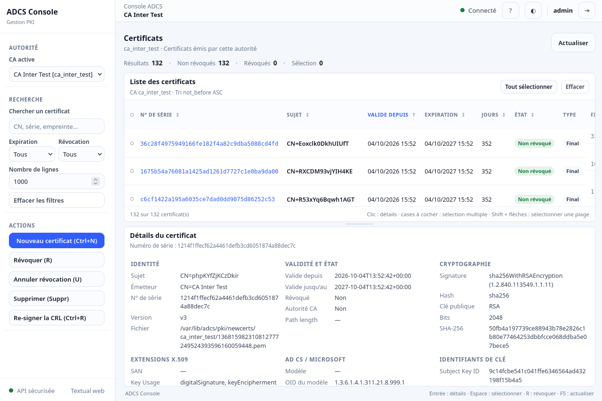

# ADCS Web Console

A proof of concept (POC) providing a web interface and JSON API for [adcs_python](https://github.com/tranquilit/adcs_python).

The project uses the existing `adcs_python` code without modifying it.




## Quick Start

Requires an existing `adcs_python` installation.

```bash
python3 start.py
```

Follow the setup instructions, then open the URL displayed in the terminal.

## Features

- Static web interface inspired by the Textual GUI
- Authenticated JSON API
- Certificate management and downloads
- Swagger UI at `/api/docs`

## Disclaimer

**Demo only.** This project is not intended for production use and is not guaranteed to be maintained or supported.
